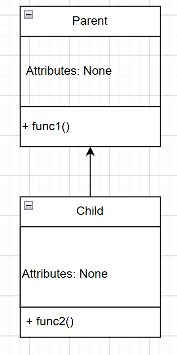
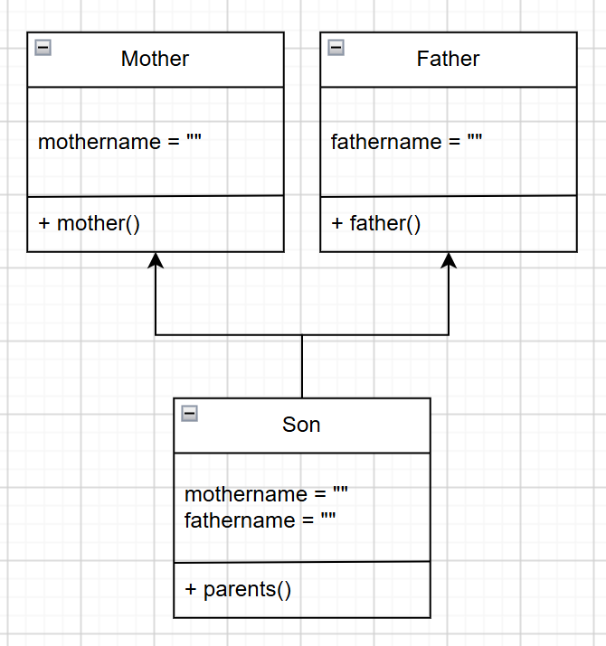
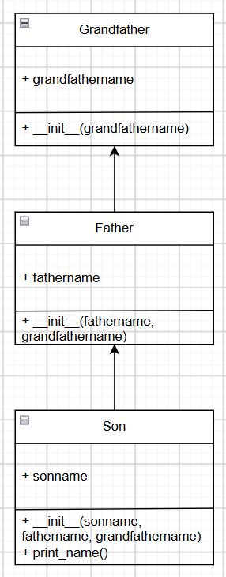

—-------------
Allotted Time: 20 minutes
Grading: Non-graded, and submission is NOT required.

Instruction: Do what is asked in each item below:

1. For each code example on single, multilevel, and hierarchical inheritance, create the
corresponding class diagram in your notebook. Clearly identify the attributes and methods of
each class. Show the correct inheritance relationship between classes.
- single inheritance: 
- multiple inheritance: 
- multilevel inheritance: 

2. Run the code examples in your IDE. Modify the code by adding getter and setter methods,
changing object values, adding new objects, and adjusting method outputs. Observe how
these changes affect the program. Experiment freely to strengthen your understanding of
inheritance.